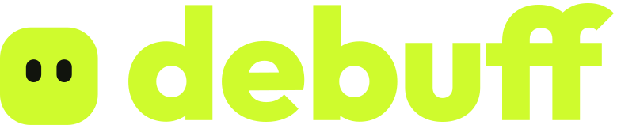
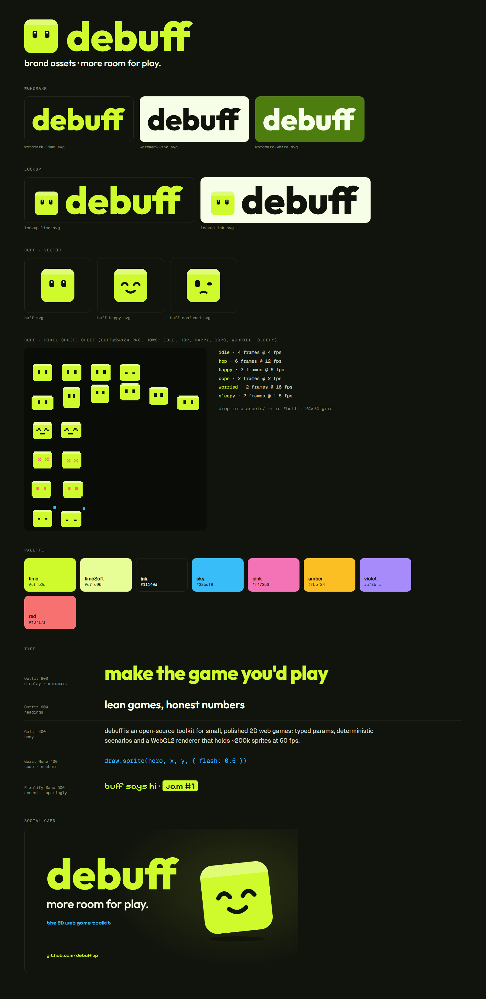

<p align="center"></p>

# debuff brand assets

Official assets for **debuff**, the 2D web game toolkit, and its mascot **buff**. Use them freely to talk about debuff, link to it, or make jam and community material.



## Files

| File | Use |
| --- | --- |
| `assets/wordmark-lime.svg` | Default wordmark, on dark backgrounds |
| `assets/wordmark-ink.svg` | Wordmark on light backgrounds, and on lime |
| `assets/wordmark-white.svg` | Wordmark on photos and dark colours (never on lime: white on lime is hard to read) |
| `assets/lockup-lime.svg` / `.png`, `assets/lockup-ink.svg` | buff + wordmark |
| `assets/buff.svg`, `buff-happy.svg`, `buff-confused.svg`, `buff-512.png` | buff, vector |
| `assets/buff@24x24.png` + `.json` | buff pixel sprite sheet (idle, hop, happy, oops, worried, sleepy). Drop it into a debuff project's `assets/` folder and it's sliced into 24×24 frames automatically |
| `assets/social-card.png` | 1200×630 link preview |
| `assets/org-logo.svg`, `org-logo-{256,512,1024}.png` | The **Debuff Foundation** mark: a black down-right arrow in a lime square, on a transparent background. Used for the GitHub org and the foundation |

## Basics

- The name is always lowercase: **debuff**, and the mascot is **buff**.
- Colours: lime `#cffb2d`, limeSoft `#e7fd96`, ink `#11140d`. Anything filled with lime takes ink text, never white. Accents are sky `#38bdf8`, pink `#f472b6`, amber `#fbbf24` and violet `#a78bfa`.
- Fonts (all OFL): Outfit (display and wordmark), Geist (body), Geist Mono (code), Pixelify Sans (pixel accents).
- Please don't recolour, stretch or redraw the wordmark or buff, or use them to suggest an official endorsement.

## Regenerate

Everything is generated from `scripts/build.mjs` (Outfit outlined with fontkit, rendered in headless Chrome):

```bash
npm install
npm run build
```

## Licence

The assets are licensed CC BY 4.0. The fonts keep their own OFL licences.
